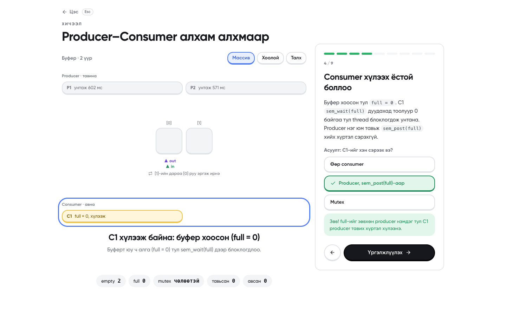
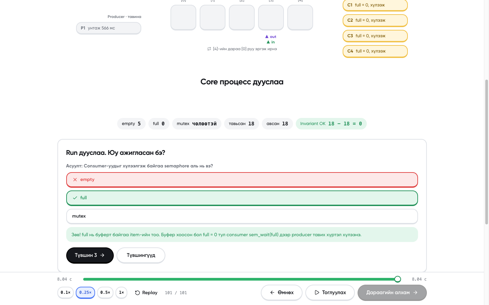
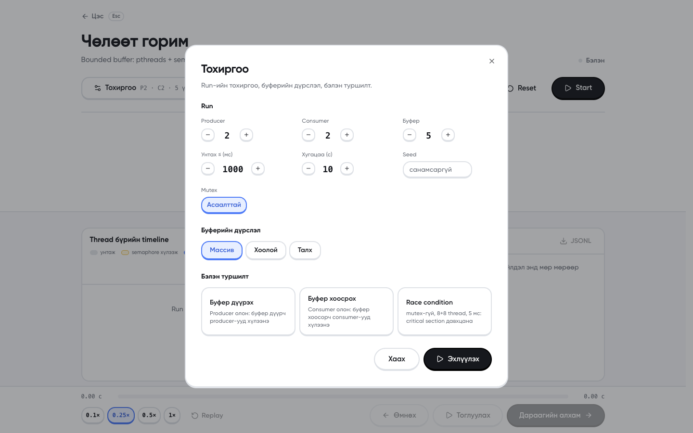
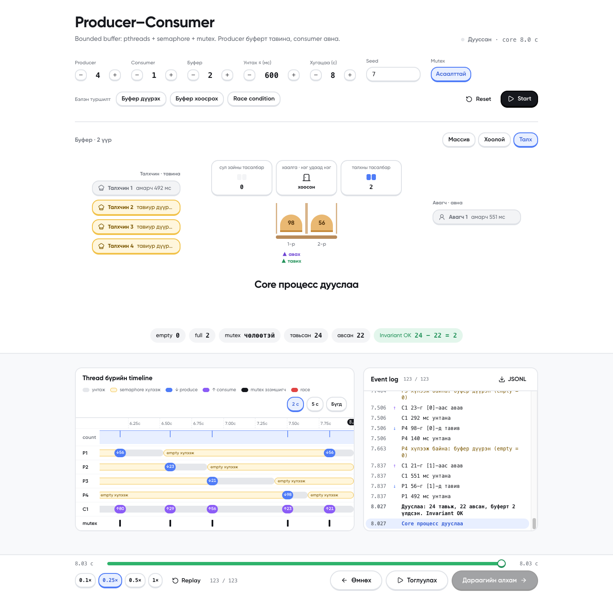

# II-4-12 · Producer–Consumer · Manual

F.CSM302 Үйлдлийн систем · Бие даалт 1 · Ноорог (2026-10-19). Энэ файлыг `II-4-12_Manual.pdf` болгон хөрвүүлнэ.

---

## 8.1 Хэрэглэгчийн заавар

### Програмын зорилго
Сурах бичгийн 7-р бүлгийн Producer–Consumer (bounded buffer) төслийг C хэл дээр pthreads, POSIX semaphore (`empty`, `full`), `mutex`-ээр хэрэгжүүлсэн. Producer thread-үүд санамсаргүй тоо (0–99) тойрог буферт тавьж, consumer thread-үүд авна. Браузер дээрх дэлгэц нь **бодит C программын** thread бүрийн үйлдлийг (унтах, semaphore хүлээх, тавих, авах) буферийн анимаци болон thread бүрийн timeline хэлбэрээр харуулна. Дэлгэц зөвхөн харуулдаг, бүх синхрончлол C core дотор явагдана.

### Дэмжих орчин
- macOS (Apple Silicon / Intel), Linux (Ubuntu 22.04+), Windows-д **WSL2 Ubuntu** дотор.
- Браузер: Chrome, Safari, Firefox-ийн сүүлийн хувилбар.
- Windows дээр шууд (WSL-гүй) ажиллахгүй: `pc.c` нь pthreads ба POSIX semaphore ашигладаг.

### Суулгах, нээх
```bash
git clone https://github.com/khuslenshi/os-bd1-producer-consumer.git
cd os-bd1-producer-consumer
npm install
npm run dev
```
Дараа нь браузерт **http://localhost:3000**-ийг нээхэд эхлэлийн цэс гарна. `npm run dev` нь эхлээд C core-ийг (`src/core/pc`) автоматаар build хийнэ.

### Эхлэлийн цэс
Нээхэд тоглоомын цэс шиг эхлэлийн дэлгэц гарна (зураг 8): голд гарчиг, доор нь 2 том товч нэг мөрөнд (Хичээл ба заавар, Түвшингүүд), хоёр дахь мөрөнд бүтэн өргөнтэй Тухай товч. Гарчгийн дээрх 5 нүд нь жинхэнэ C core-ийн жижиг run бөгөөд тасралтгүй эргэлдэнэ. **← →** (эсвэл ↑ ↓) сонгох, **Enter** нээх, **1–2** горим, **3** Тухай, бусад дэлгэцээс **Esc** дарж цэс рүү буцна.

| Цэс | Хаяг | Юу хийх вэ |
|---|---|---|
| **Хичээл ба заавар** | `/learn` | 12 алхамтай хичээл (зураг 9). Эхний 5 алхам ойлголтыг заана: талхны дэлгүүрийн жишээ, яагаад буфер хэрэгтэй, гурван асуудал (дүүрэн, хоосон, race condition), компьютер дээрх буфер (thread, массив, бодит жишээ), empty/full/mutex багаж. Дараагийн 7 алхам бодит run-ийг алхам алхмаар тоглуулж, тухайн хэсгийг цэнхэр хүрээгээр тодруулна. Буферийн дүрслэл алхмаас хамаарч өөрөө солигдоно: эхлээд Талх, дараа нь Хоолой, Массив. 5 алхамд асуулт байгаа, зөв хариулсны дараа үргэлжилнэ. Алхам бүрийг дуу хоолойгоор уншина (ElevenLabs, урьдчилан бичсэн `public/audio/learn/*.m4a`): тоглуулах/зогсоох товч, slider-аар гүйлгэж болно. Тавих/авах/хүлээх үед болон хариултад богино дуу гарна. `/learn`-ийг шууд хаягаар нээвэл browser эхний уншлагыг хааж магадгүй, тэр үед тоглуулах товчийг дарна. |
| **Түвшингүүд** | `/levels` | 3 даалгавар: Буфер дүүрэх, Буфер хоосрох, Race condition. Тохиргоо нь түгжигдсэн, Start дараад ажигласны дараа run дуусахад асуулт гарна (зураг 10). Зөв хариулсан түвшин "Дууссан" гэж тэмдэглэгдэнэ (тухайн browser-т хадгалагдана). |
| **Чөлөөт горим** | `/play` | Түвшингүүд хуудасны **Өөрийн туршилт** картаар нээгдэнэ. Бүх тохиргоог өөрөө сонгох горим. Доорх оролт, тохиргоо, удирдлагын тайлбар энэ горимд хамаарна. |
| **Тухай** | `/about` | Төсөл, баг, C core → Next.js route → browser хэрхэн холбогддог, гол ойлголтууд. |






### Оролт ба тохиргоо
| Талбар | Утга | Хүрээ | Анхдагч |
|---|---|---|---|
| Producer | producer thread-ийн тоо | 0–16 | 2 |
| Consumer | consumer thread-ийн тоо | 0–16 | 2 |
| Буфер | тойрог буферийн үүрийн тоо | 1–16 | 5 |
| Унтах ≤ (мс) | thread бүр үйлдэл хооронд 0..энэ хугацаагаар санамсаргүй унтана | 0–5000 | 1000 |
| Хугацаа (с) | run хэдэн секунд үргэлжлэх | 1–60 | 10 |
| Seed | санамсаргүй тооны эх утга; ижил seed = ижил унтах хугацаа | 0–2147483647, хоосон бол санамсаргүй | хоосон |
| mutex | унтраавал critical section хамгаалалтгүй болж race condition гарна | асаах/унтраах | асаалттай |

Чөлөөт горимд бүх тохиргоо **Тохиргоо** товчоор нээгдэх цонхонд байна (зураг 11): Run-ий тоонууд, seed, mutex, буферийн дүрслэл (Массив / Хоолой / Талх), бэлэн туршилтууд. Товчны хажууд одоогийн тохиргооны хураангуй (жишээ нь `P2 · C2 · 5 үүр · mutex · Массив`) харагдана. Түвшний хуудсанд run-ий тохиргоо түгжээтэй, зөвхөн дүрслэлийг сольж болно. Тоо бүрийг **− / +** товчоор эсвэл шууд бичиж өөрчилнө. Хүрээнээс гадуур утга оруулбал тоо улаан болж, Start дарахад алдааны тайлбар гарна (зураг 6).

### Ажиллуулах, зогсоох, reset
- **Start** (эсвэл Тохиргоо цонхны **Эхлүүлэх**): тохиргоогоор шинэ run эхлүүлнэ. Цонхны бэлэн туршилтын товч (Буфер дүүрэх / Буфер хоосрох / Race condition) тохиргоог бөглөөд шууд эхлүүлж, цонхыг хаана.
- **Stop**: ажиллаж буй C процессыг зогсооно, тэр хүртэлх event-үүд үлдэнэ.
- **Reset**: run-ийг зогсоож дэлгэцийг цэвэрлэнэ.
- Timeline дээр **дарж эсвэл чирж** аль ч агшин руу очно. `←` `→` нэг event, `Shift + ←/→` 10 event, `Space` pause/play.
- **Доод bar** (дэлгэцийн доор үргэлж харагдана): дээд мөрөнд видео тоглуулагч шиг **slider**, чирж аль ч event руу очно (зүүн талд одоогийн хугацаа, баруун талд нийт хугацаа). Доод мөрөнд **0.1× 0.25× 0.5× 1×** тоглуулах хурд (анхдагч 0.25×, 1× = бодит хугацаа), **Replay**, **← Өмнөх**, **Тоглуулах / Түр зогсоох**, том хар **Дараагийн алхам →** товч (нэг event урагшилна).
- **Event log** (өргөн дэлгэц дээр баруун талд, нарийн дэлгэц дээр timeline-ий доор): тоглогдсон event бүр доороос нэмэгдэж, шинэ мөр үргэлж харагдана. Мөр дээр дарж тэр агшин руу очно. **JSONL** товчоор бүх event-ийг файлаар татна.
- C core бодит хугацаагаар ажилладаг, дэлгэц түүнийг сонгосон хурдаар араас нь тоглуулна. Core илгээсэн боловч хараахан тоглогдоогүй хэсэг timeline дээр бүдэг харагдана.
- Timeline-ий баруун дээд буланд **2 с / 5 с / Бүгд** цонх: анхдагч нь 2 с; 2 с, 5 с үед timeline playhead-ийг дагаж гүйнэ.

### Дүрслэлийн тэмдэг, өнгө, төлөв
**Буферийн дүрслэл (дээд хэсэг)**. Тохиргоо цонхны "Буферийн дүрслэл" хэсгээс **Массив / Хоолой / Талх** гурвын аль нэгийг сонгоно (Хичээл дээр буферийн баруун дээд буланд). Гурвуулаа ижил өгөгдлийг харуулна.
- **Массив** (сурах бичгийн Figure 7.1 шиг): буфер = нүдний мөр (circular array). Цэнхэр нүдэнд item байна, саарал нүд хоосон, яг одоо хандсан нүд ногоон болж дээш өргөгдөнө (race бол улаан). **▲in** (ногоон) нь producer-ийн дараагийн тавих нүд, **▲out** (нил ягаан) нь consumer-ийн дараагийн авах нүд, хоёулаа гулсаж шилжинэ. Сүүлийн нүдний дараа [0] руу эргэж ирнэ.
- **Хоолой** (FIFO): item зүүн талаас орж, баруун талаас гарна. Хамгийн баруун талынх нь хамгийн эрт орсон тул эхэлж авагдана. Тасархай тойрог = сул зай (`empty`), цэнхэр = item (`full`). Item бүрийн доор нүдний индекс бичигдэнэ.
- **Талх** (видеоны жишээ): талхчин = producer, авагч = consumer, тавиур = буфер (модон хайрцагт нүд бүр нэг үүр, хоосон нүд тасархай хүрээтэй "сул", талх дээр item-ийн дугаар). Дээрх самбарууд: **Сул зай** = `empty`, **Хаалга** = `mutex` (онгорхой = чөлөөтэй, хаалттай бол дотор нь хэн байгаа), **Талх** = `full`. Тавиурын доор **▲ тавих** (in), **▲ авах** (out) заагч. Тайлбарын мөр энгийн үгээр гарна.
- Thread бүр нэг карт: өнгөт avatar (producer цэнхэр, consumer ягаан), нэр, одоогийн төлөв icon-той (сар = унтаж, элсэн цаг = хүлээж). Тавьж/авч байх агшинд карт өргөгдөж, гартаа item-ийн дугаартай байна; mutex барьж буй thread цоожтой, хар хүрээтэй.
- Item тавихад producer-оос нүд рүү бөмбөлөг нисэж очно, авахад нүднээс consumer руу нисэнэ.
- Producer, буфер, consumer гурвын хооронд **тавина →** ба **авна →** сум байна (нарийн дэлгэц дээр ↓). Тавих/авах агшинд тухайн сум цэнхэр/ягаан болж item-ийн дугаарыг харуулна, тал нь хүлээж байвал шар "хүлээж байна" болно.
- Буферийн доор том үсгээр одоогийн event, түүний доор "яагаад" гэсэн нэг мөр тайлбар (аль semaphore блоклосон, mutex-ийг хэн барьж байгаа) гарна. Доор нь `empty`, `full`, `mutex`, тавьсан, авсан тоо болон төгсгөлд invariant.
- Thread chip: саарал = унтаж байна, шар = semaphore хүлээж байна, ногоон = producer буферт тавьж байна, нил ягаан = consumer авч байна, хар хүрээ + цоож = mutex эзэмшиж байна.

**Thread timeline (доод хэсэг)**
| Өнгө | Утга |
|---|---|
| саарал зурвас | унтаж байна (`sleep`) |
| шар зурвас | semaphore хүлээж байна (`wait_empty`: буфер дүүрэн, `wait_full`: буфер хоосон) |
| цэнхэр `↓27` | produce: 27-г буферт тавив (ойрхон олон event байвал нарийн зураас болно, хулганаар заахад дэлгэрэнгүй гарна) |
| нил ягаан `↑27` | consume: 27-г буферээс авав |
| хар `P2` (mutex мөр) | mutex-ийг тэр агшинд эзэмшсэн thread |
| улаан | race: тухайн агшинд өөр thread зэрэг critical section-д байсан |
| `count` мөр | буферт байгаа item-ийн тоо цаг хугацааны дагуу |

### Жишээ
**Жишээ 1. Буфер дүүрэх** (P=4, C=1, буфер=2, ≤600 мс, 8 с, seed 7). Producer олон, consumer ганц тул буфер хурдан дүүрнэ: `empty` мөр хоосорч, producer-ууд шар (`empty = 0, хүлээж`) болно. Timeline дээр P1–P4-ийн мөрөнд урт шар зурвас харагдана. Төгсгөлд `Invariant OK`.


**Жишээ 2. Буфер хоосрох** (P=1, C=4, буфер=5, "Хоолой" дүрслэлээр). Consumer олон тул буфер ихэнхдээ хоосон: хоолой бүхэлдээ тасархай тойрог (`full = 0`), consumer-ууд шар (`full = 0, хүлээж`).


**Жишээ 3. Race condition** (P=8, C=8, буфер=5, ≤5 мс, 1 с, mutex унтраалттай). Critical section хамгаалалтгүй тул timeline дээр олон улаан тэмдэг гарна. "Эхнийх рүү" дарж эхний race руу очиход доор нь тайлбар гарна, жишээ нь "count = 2, 3 байх ёстой". Зарим run-д төгсгөлд `Invariant БУРУУ` (тавьсан − авсан ≠ буферт) гарна, энэ нь шинэчлэл алдагдсаныг (lost update) баталгаажуулна. Mutex-тэй ижил тохиргоонд race 0 гарна.


**Жишээ 4. Талхны дэлгүүрээр** ("Талх" дүрслэл, Буфер дүүрэх тохиргоо). Талхчид шар картаар "тавиур дүүрэн, хүлээж", Сул зай 0, Талх 2.




### Түгээмэл алдаа ба шийдэл
| Алдаа | Шалтгаан | Шийдэл |
|---|---|---|
| `Буфер: 1..16 хооронд байх ёстой` | хүрээнээс гадуур утга | талбарын хүрээнд утга оруулна (зураг 6) |
| `C core build хийгдээгүй байна` | `src/core/pc` байхгүй | `make -C src/core` эсвэл `npm run dev`-ээр дахин эхлүүлнэ |
| `Зэрэг 4-өөс олон run…` | 4-өөс олон tab зэрэг run хийж байна | бусад tab-ийн run-ийг Stop хийнэ |
| `npm: command not found` | Node суугаагүй | Node.js 20+ суулгана |
| `make: cc: No such file` | C compiler байхгүй | macOS: `xcode-select --install`, Ubuntu/WSL: `sudo apt install build-essential` |
| Port 3000 эзэлсэн | өөр программ ашиглаж байна | `npm run dev -- -p 3100` |


---

## 8.2 Operational заавар

### Repository clone
```bash
git clone https://github.com/khuslenshi/os-bd1-producer-consumer.git
cd os-bd1-producer-consumer
```

### OS, compiler/runtime, version
Туршсан орчин:
| Орчин | OS | Compiler | Node | Python |
|---|---|---|---|---|
| Хөгжүүлэгчийн Mac | macOS 27.0.1, arm64 | Apple clang 21.0.0 | 26.5.1 (npm 11.17.0) | 3.14.6 |
| GitHub Actions | ubuntu-latest | gcc (`-Werror`) | 24 | 3 (runner) |
| GitHub Actions | macos-latest | Apple clang (`-Werror`) | 24 | 3 (runner) |

Шаардлага: C compiler + `make`, Node.js 20 эсвэл түүнээс дээш. Python 3 нь зөвхөн `tests/run_tests.py`-д хэрэгтэй.

### Dependency суулгах
```bash
npm install          # хөгжүүлэлтэд
npm ci               # CI эсвэл яг lockfile-ийн хувилбараар
```
Бүх package-ийн хувилбар `package.json`-д яг тогтоогдсон, `package-lock.json` repo-д бий.

### Build ба Run
```bash
npm run dev                       # хөгжүүлэлтийн горим, http://localhost:3000
npm run build && npm start        # production горим
make -C src/core                  # зөвхөн C core
./src/core/pc 10 3 2 --buffer 5 --sleep-max 1000   # core-ийг командаас (JSON мөр хэвлэнэ)
```

### Үндсэн тестийн өгөгдөл
```bash
npm test
```
- `src/lib/model.test.ts` (3 тест): event → timeline хөрвүүлэлт, race илрүүлэлт. Үүний нэг нь **бодит core**-ийг ажиллуулна: mutex-тэй (8+8 thread, 5 мс) run-д race 0, mutex-гүй run-д race > 0 байх ёстой.
- `tests/run_tests.py` (18 тест): T1–T4 үндсэн (1P+1C, буфер дүүрэх, хоосрох, invariant).

### Нэмэлт boundary / error тест
- `tests/run_tests.py`: B1–B6 (буфер=1, sleep=0, 100+100 thread, буфер=64, 0 consumer, 0 producer), E1–E7 (буруу аргумент), S1 (SIGTERM-ээр 1 с-д зогсох).
- `/api/run`-ийн шалгалт (CI-д):
```bash
curl -s 'http://localhost:3000/api/run?buffer=0'                        # 400 + алдааны тайлбар
curl -sN 'http://localhost:3000/api/run?duration=1&producers=2&consumers=2&buffer=5&sleepMax=50&mutex=1' | tail -2   # ... "invariant_ok":true
```

### Хүлээгдсэн үр дүн
- `npm test`: `pass 3`, дараа нь `18/18 PASS`.
- Mutex-тэй бүх run: `Invariant OK`, race 0.
- Mutex-гүй race сценари: race тэмдэг > 0, зарим run-д `Invariant БУРУУ`.
- GitHub Actions: `Build & test (ubuntu-latest)`, `Build & test (macos-latest)` ногоон.

### Known issues
- Нэг run-д 20 000-аас олон event ирвэл core-ийг зогсоож анхааруулна (`Унтах ≤` 0–5 мс, олон thread үед).
- Event-үүд олон (600+) үед timeline-ийн шошго нуугдаж нарийн зураас болно, item нисэх анимаци унтарна. Ойрхон event-үүдийн шошгыг харахын тулд 2 с цонх ашиглана.
- Mutex-гүй үед log-ийн дараалал өөрөө бодит дараалалтай яг таарахгүй (log бичих нь critical section-оос гадна), тиймээс race-ийг `count`-ийн зөрүүгээр илрүүлдэг.
- Нэг машин дээр зэрэг 4 хүртэл run.
