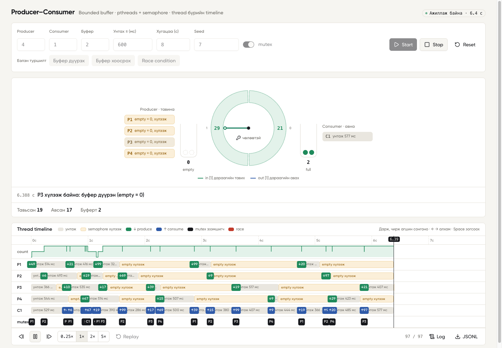
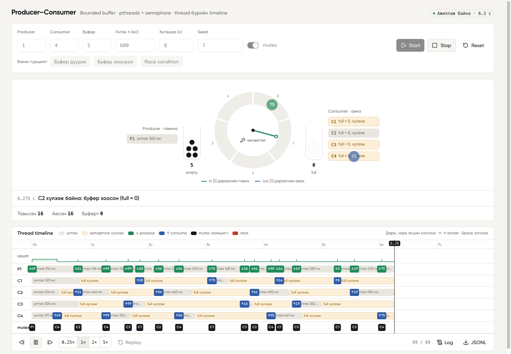
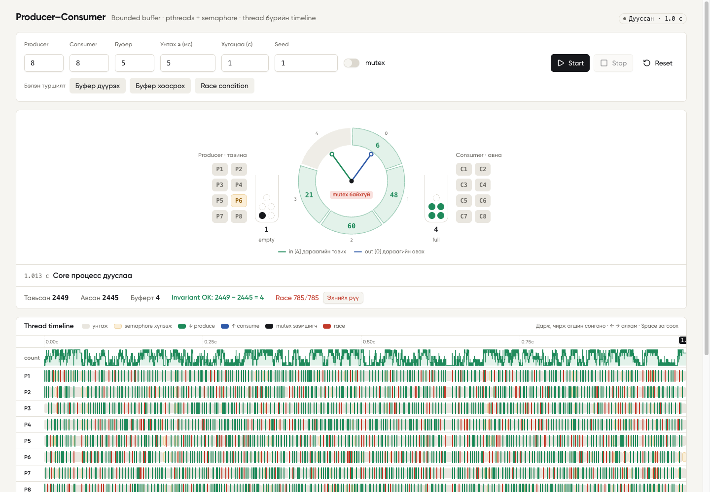
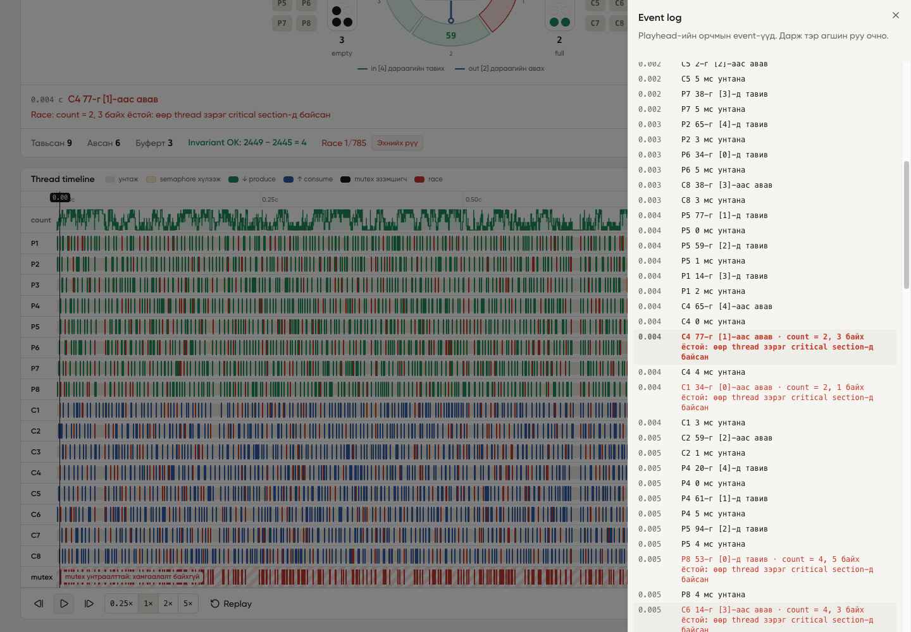
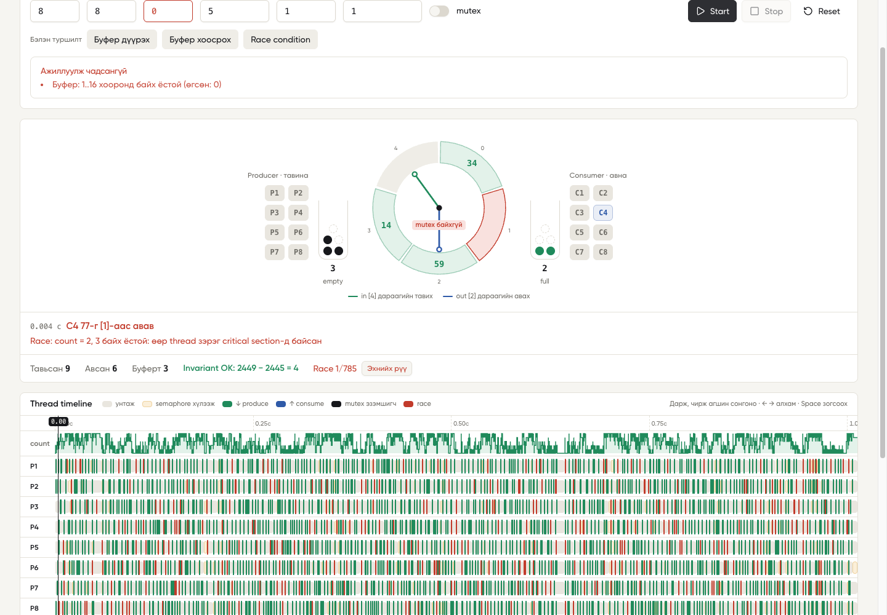

# II-4-12 · Producer–Consumer · Manual

F.CSM302 Үйлдлийн систем · Бие даалт 1 · Ноорог (2026-10-19). Энэ файлыг `II-4-12_Manual.pdf` болгон хөрвүүлнэ.

---

## 8.1 Хэрэглэгчийн заавар

### Програмын зорилго
Сурах бичгийн 7-р бүлгийн Producer–Consumer (bounded buffer) төслийг C хэл дээр pthreads, POSIX semaphore (`empty`, `full`), `mutex`-ээр хэрэгжүүлсэн. Producer thread-үүд санамсаргүй тоо (0–99) тойрог буферт тавьж, consumer thread-үүд авна. Браузер дээрх дэлгэц нь **бодит C программын** thread бүрийн үйлдлийг (унтах, semaphore хүлээх, тавих, авах) буферийн анимаци болон thread бүрийн timeline хэлбэрээр харуулна. Дэлгэц зөвхөн харуулдаг, бүх синхрончлол C core дотор явагдана.

### Дэмжих орчин
- macOS (Apple Silicon / Intel), Linux (Ubuntu 22.04+), Windows-д **WSL2 Ubuntu** дотор.
- Браузер: Chrome, Safari, Firefox-ийн сүүлийн хувилбар.
- Windows дээр шууд (WSL-гүй) ажиллахгүй: `pc.c` нь pthreads ба POSIX semaphore ашигладаг.

### Суулгах, нээх
```bash
git clone https://github.com/khuslenshi/os-bd1-producer-consumer.git
cd os-bd1-producer-consumer
npm install
npm run dev
```
Дараа нь браузерт **http://localhost:3000**-ийг нээнэ. `npm run dev` нь эхлээд C core-ийг (`src/core/pc`) автоматаар build хийнэ.

### Оролт ба тохиргоо
| Талбар | Утга | Хүрээ | Анхдагч |
|---|---|---|---|
| Producer | producer thread-ийн тоо | 0–16 | 2 |
| Consumer | consumer thread-ийн тоо | 0–16 | 2 |
| Буфер | тойрог буферийн үүрийн тоо | 1–16 | 5 |
| Унтах ≤ (мс) | thread бүр үйлдэл хооронд 0..энэ хугацаагаар санамсаргүй унтана | 0–5000 | 1000 |
| Хугацаа (с) | run хэдэн секунд үргэлжлэх | 1–60 | 10 |
| Seed | санамсаргүй тооны эх утга; ижил seed = ижил унтах хугацаа | 0–2147483647, хоосон бол санамсаргүй | хоосон |
| mutex | унтраавал critical section хамгаалалтгүй болж race condition гарна | асаах/унтраах | асаалттай |

Хүрээнээс гадуур утга оруулбал талбар улаан болж, Start дарахад алдааны тайлбар гарна (зураг 6).

### Ажиллуулах, зогсоох, reset
- **Start**: тохиргоогоор шинэ run эхлүүлнэ. Бэлэн туршилтын товч (Буфер дүүрэх / Буфер хоосрох / Race condition) тохиргоог бөглөөд шууд эхлүүлнэ.
- **Stop**: ажиллаж буй C процессыг зогсооно, тэр хүртэлх event-үүд үлдэнэ.
- **Reset**: run-ийг зогсоож дэлгэцийг цэвэрлэнэ.
- Timeline дээр **дарж эсвэл чирж** аль ч агшин руу очно. `←` `→` нэг event, `Shift + ←/→` 10 event, `Space` pause/play.
- Доод мөр: ⏮ ⏯ ⏭ алхам, **Live** (run явж байхад хамгийн сүүлийн event рүү буцах), **0.25× 1× 2× 5×** replay хурд, **Replay**, **Log** (event-ийн жагсаалт), **JSONL** (бүх event-ийг файлаар татах).

### Дүрслэлийн тэмдэг, өнгө, төлөв
**Буферийн анимаци (дээд хэсэг)**
- **Тойрог** = circular array. Ногоон үүр дотор item байна, саарал үүр хоосон. Үүрийн гадна талын тоо нь индекс.
- **Ногоон зүү = `in`** (producer дараагийн тавих үүр), **цэнхэр зүү = `out`** (consumer дараагийн авах үүр). Зүү нь тойргийн дагуу эргэлдэнэ.
- Item тавихад ногоон бөмбөлөг producer-оос үүр рүү, авахад цэнхэр бөмбөлөг үүрнээс consumer руу нисэнэ.
- **`empty` ваар**: хар токен бүр нэг хоосон үүр. **`full` ваар**: ногоон токен бүр нэг дүүрсэн үүр. `sem_wait` нэг токен авна, токен байхгүй бол thread хүлээнэ.
- **Түлхүүр тэмдэг**: mutex-ийг одоо эзэмшиж буй thread (тойргийн голд болон thread-ийн chip дээр). Mutex унтраалттай бол "mutex байхгүй" гэж улаанаар гарна.
- Thread chip: саарал = унтаж байна, шар = semaphore хүлээж байна, ногоон/цэнхэр = буферт тавьж/авч байна.

**Thread timeline (доод хэсэг)**
| Өнгө | Утга |
|---|---|
| саарал зурвас | унтаж байна (`sleep`) |
| шар зурвас | semaphore хүлээж байна (`wait_empty`: буфер дүүрэн, `wait_full`: буфер хоосон) |
| ногоон `↓27` | produce: 27-г буферт тавив |
| цэнхэр `↑27` | consume: 27-г буферээс авав |
| хар `P2` (mutex мөр) | mutex-ийг тэр агшинд эзэмшсэн thread |
| улаан | race: тухайн агшинд өөр thread зэрэг critical section-д байсан |
| `count` мөр | буферт байгаа item-ийн тоо цаг хугацааны дагуу |

### Жишээ
**Жишээ 1. Буфер дүүрэх** (P=4, C=1, буфер=2, ≤600 мс, 8 с, seed 7). Producer олон, consumer ганц тул буфер хурдан дүүрнэ: `empty` ваар хоосорч, producer-ууд шар (`empty = 0, хүлээж`) болно. Timeline дээр P1–P4-ийн мөрөнд урт шар зурвас харагдана. Төгсгөлд `Invariant OK`.



**Жишээ 2. Буфер хоосрох** (P=1, C=4, буфер=5). Consumer олон тул буфер ихэнхдээ хоосон: `full` ваар хоосон, consumer-ууд шар (`full = 0, хүлээж`).



**Жишээ 3. Race condition** (P=8, C=8, буфер=5, ≤5 мс, 1 с, mutex унтраалттай). Critical section хамгаалалтгүй тул timeline дээр олон улаан тэмдэг гарна. "Эхнийх рүү" дарж эхний race руу очиход доор нь тайлбар гарна, жишээ нь "count = 2, 3 байх ёстой". Зарим run-д төгсгөлд `Invariant БУРУУ` (тавьсан − авсан ≠ буферт) гарна, энэ нь шинэчлэл алдагдсаныг (lost update) баталгаажуулна. Mutex-тэй ижил тохиргоонд race 0 гарна.




### Түгээмэл алдаа ба шийдэл
| Алдаа | Шалтгаан | Шийдэл |
|---|---|---|
| `Буфер: 1..16 хооронд байх ёстой` | хүрээнээс гадуур утга | талбарын хүрээнд утга оруулна (зураг 6) |
| `C core build хийгдээгүй байна` | `src/core/pc` байхгүй | `make -C src/core` эсвэл `npm run dev`-ээр дахин эхлүүлнэ |
| `Зэрэг 4-өөс олон run…` | 4-өөс олон tab зэрэг run хийж байна | бусад tab-ийн run-ийг Stop хийнэ |
| `npm: command not found` | Node суугаагүй | Node.js 20+ суулгана |
| `make: cc: No such file` | C compiler байхгүй | macOS: `xcode-select --install`, Ubuntu/WSL: `sudo apt install build-essential` |
| Port 3000 эзэлсэн | өөр программ ашиглаж байна | `npm run dev -- -p 3100` |



---

## 8.2 Operational заавар

### Repository clone
```bash
git clone https://github.com/khuslenshi/os-bd1-producer-consumer.git
cd os-bd1-producer-consumer
```

### OS, compiler/runtime, version
Туршсан орчин:
| Орчин | OS | Compiler | Node | Python |
|---|---|---|---|---|
| Хөгжүүлэгчийн Mac | macOS 27.0.1, arm64 | Apple clang 21.0.0 | 26.5.1 (npm 11.17.0) | 3.14.6 |
| GitHub Actions | ubuntu-latest | gcc (`-Werror`) | 24 | 3 (runner) |
| GitHub Actions | macos-latest | Apple clang (`-Werror`) | 24 | 3 (runner) |

Шаардлага: C compiler + `make`, Node.js 20 эсвэл түүнээс дээш. Python 3 нь зөвхөн `tests/run_tests.py`-д хэрэгтэй.

### Dependency суулгах
```bash
npm install          # хөгжүүлэлтэд
npm ci               # CI эсвэл яг lockfile-ийн хувилбараар
```
Бүх package-ийн хувилбар `package.json`-д яг тогтоогдсон, `package-lock.json` repo-д бий.

### Build ба Run
```bash
npm run dev                       # хөгжүүлэлтийн горим, http://localhost:3000
npm run build && npm start        # production горим
make -C src/core                  # зөвхөн C core
./src/core/pc 10 3 2 --buffer 5 --sleep-max 1000   # core-ийг командаас (JSON мөр хэвлэнэ)
```

### Үндсэн тестийн өгөгдөл
```bash
npm test
```
- `src/lib/model.test.ts` (3 тест): event → timeline хөрвүүлэлт, race илрүүлэлт. Үүний нэг нь **бодит core**-ийг ажиллуулна: mutex-тэй (8+8 thread, 5 мс) run-д race 0, mutex-гүй run-д race > 0 байх ёстой.
- `tests/run_tests.py` (18 тест): T1–T4 үндсэн (1P+1C, буфер дүүрэх, хоосрох, invariant).

### Нэмэлт boundary / error тест
- `tests/run_tests.py`: B1–B6 (буфер=1, sleep=0, 100+100 thread, буфер=64, 0 consumer, 0 producer), E1–E7 (буруу аргумент), S1 (SIGTERM-ээр 1 с-д зогсох).
- `/api/run`-ийн шалгалт (CI-д):
```bash
curl -s 'http://localhost:3000/api/run?buffer=0'                        # 400 + алдааны тайлбар
curl -sN 'http://localhost:3000/api/run?duration=1&producers=2&consumers=2&buffer=5&sleepMax=50&mutex=1' | tail -2   # ... "invariant_ok":true
```

### Хүлээгдсэн үр дүн
- `npm test`: `pass 3`, дараа нь `18/18 PASS`.
- Mutex-тэй бүх run: `Invariant OK`, race 0.
- Mutex-гүй race сценари: race тэмдэг > 0, зарим run-д `Invariant БУРУУ`.
- GitHub Actions: `Build & test (ubuntu-latest)`, `Build & test (macos-latest)` ногоон.

### Known issues
- Нэг run-д 20 000-аас олон event ирвэл core-ийг зогсоож анхааруулна (`Унтах ≤` 0–5 мс, олон thread үед).
- Event-үүд олон (600+) үед timeline-ийн шошго нуугдаж нарийн зураас болно, item нисэх анимаци унтарна.
- Mutex-гүй үед log-ийн дараалал өөрөө бодит дараалалтай яг таарахгүй (log бичих нь critical section-оос гадна), тиймээс race-ийг `count`-ийн зөрүүгээр илрүүлдэг.
- Нэг машин дээр зэрэг 4 хүртэл run.
